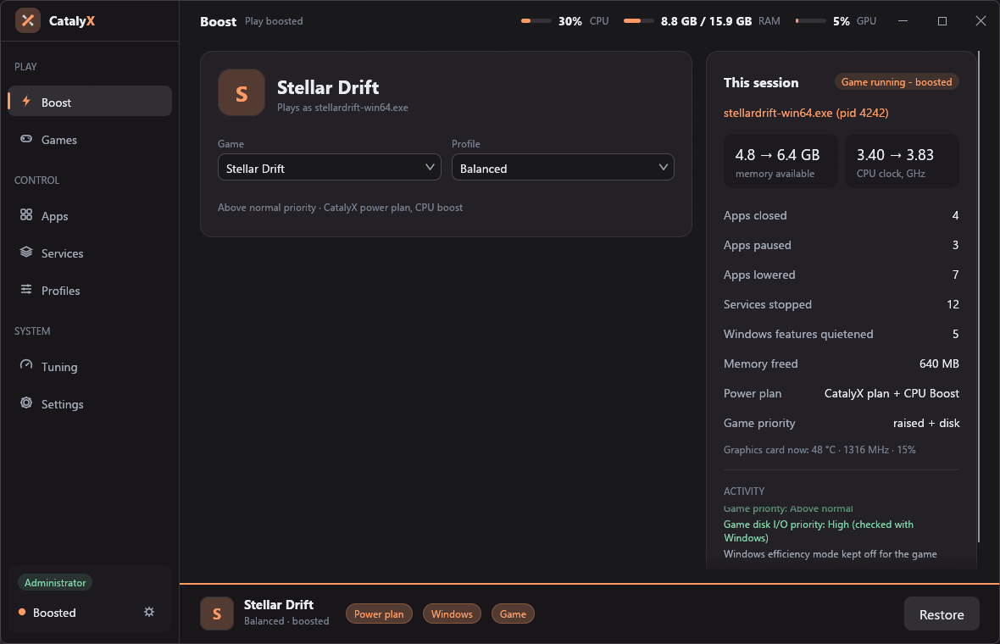
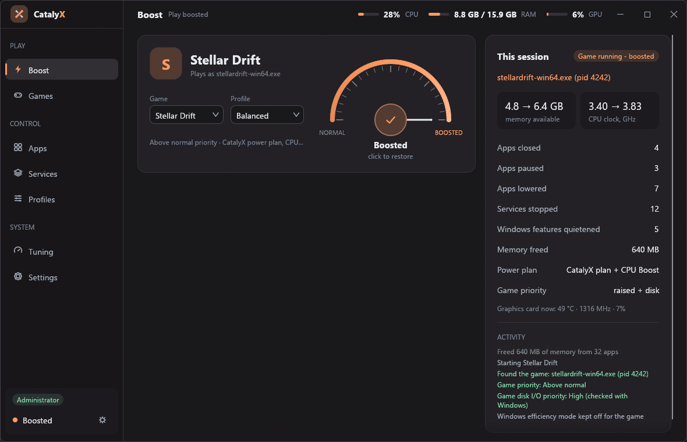
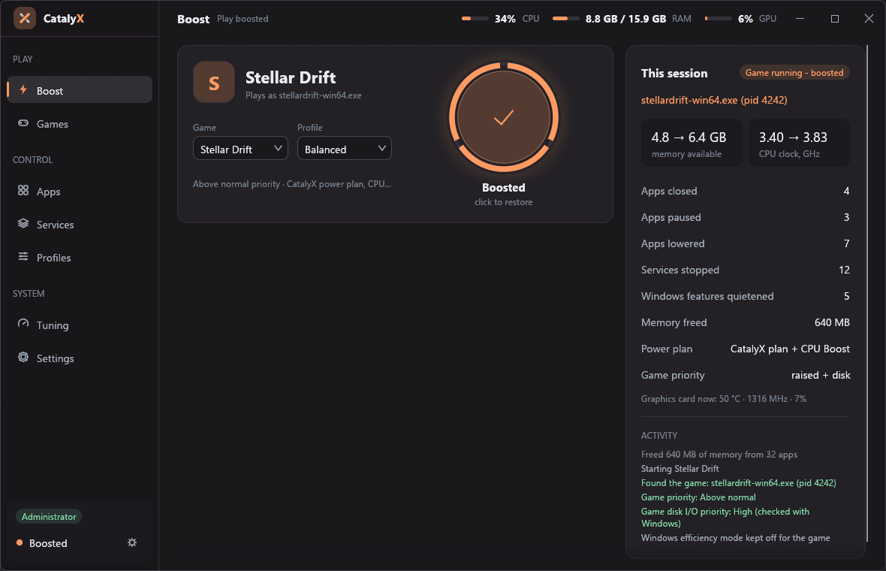
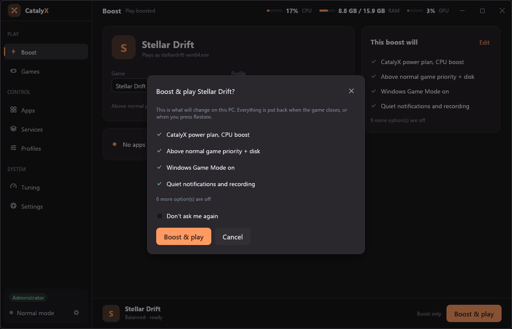
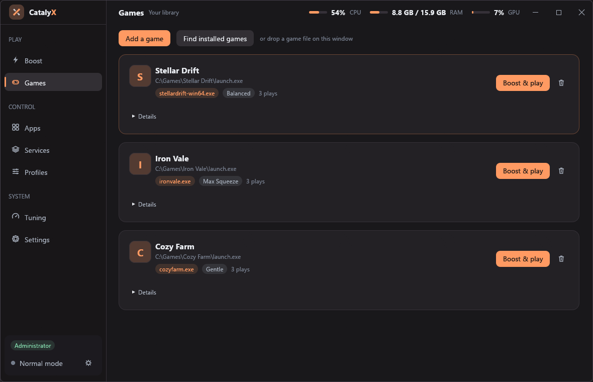
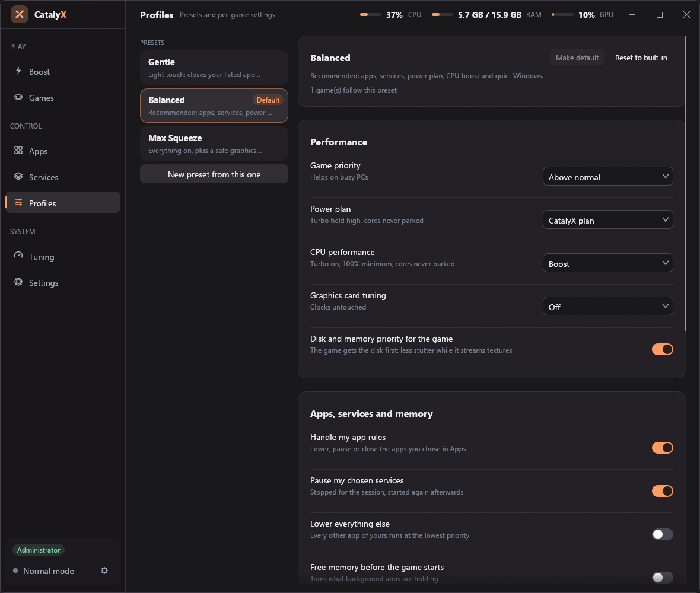
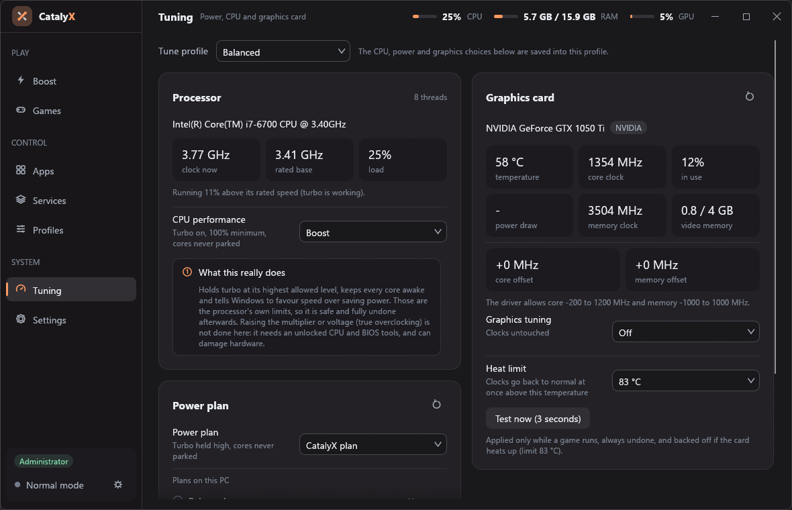
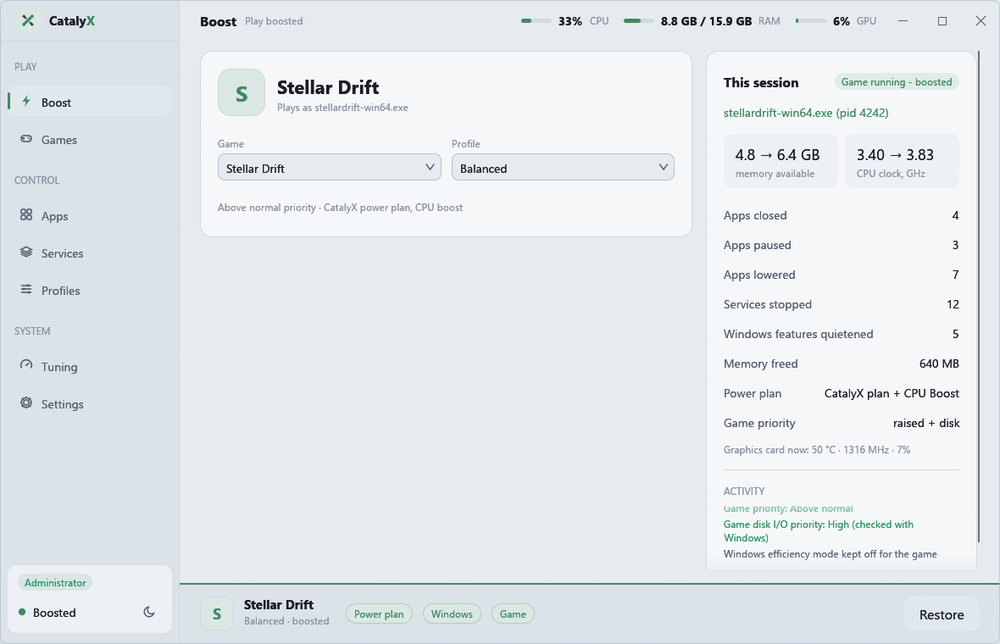

<div align="center">


# CatalyX

**A lean, ad-free game booster for Windows that puts everything back.**

One button, per-game profiles, a safe graphics-card tune, a quiet desktop while you play, and nothing
running in the background. No ads, no updater, no tray icon, no telemetry.

[](https://github.com/TheMR-777/CatalyX/actions/workflows/ci.yml)
[](#license)




</div>

> **Why the name?** A catalyst speeds a reaction up and comes out unchanged. That is the job: make the
> game faster, then leave Windows exactly as it was.

## What it does

When you press **Boost & play**, CatalyX prepares Windows for the game, starts it, finds the *real* game
program behind the launcher, and when the game closes it undoes every change. In this order:

1. **Power plan and CPU** - a copy of your own plan with turbo held at its highest allowed level, cores never
   parked and a performance energy preference. Read back and checked before it is claimed.
2. **Windows** - Game Mode on, background recording off, quiet notifications, scheduled maintenance paused.
3. **Services and apps you chose** - stopped, lowered, paused or closed (you decide, per app).
4. **Memory** - an optional trim of what background apps hold, and (administrator) a flush of Windows' cached
   standby memory.
5. **Graphics card** (NVIDIA, administrator) - a small clock offset, backed off at once above your heat limit.
6. **The game starts** the way a double-click starts it. It then gets higher CPU priority, high disk priority
   and protected memory pages.
7. **Quiet desktop** (Max Squeeze) - Windows' taskbar and desktop are switched off while the game runs.
8. **Restore** - when the game closes, everything is put back, and the session card shows measured
   before-and-after numbers (available memory, CPU clock) so you can see it did something.

Details with the exact Windows settings involved: [docs/HOW-IT-WORKS.md](docs/HOW-IT-WORKS.md).

## Safety first

- **Journal before change.** Every change is written to a recovery journal *before* it is made, so a crash,
  a power cut or a killed process can still be undone (`catalyx restore`).
- **Opt-in.** Nothing is closed or stopped until you choose it. "Use the suggestions" is one click and only
  ever lowers or pauses programs that hold data, and closes updaters.
- **Reversible and verifiable.** Settings are read back from Windows; `catalyx doctor` proves on *your* PC
  that each feature really works and really undoes.
- **No drivers, no injection, no overclocking tricks.** Only documented Windows controls and the NVIDIA
  driver's own offset interface. Realtime priority is never offered.

Full model: [docs/SAFETY.md](docs/SAFETY.md).

## The boost control

The one control that starts a boost has three looks, chosen in **Settings > Appearance**. They share one
state and one set of actions, so they behave identically; they differ only in how they draw:

| Launch bar (default) | Gauge | Power ring |
|---|---|---|
| a slim bar along the bottom of the Boost page: the game, a line of status, the action; stage chips and a progress line while it works | a dial whose needle sweeps from NORMAL to BOOSTED as the stages finish | a ring with one segment per stage that fills as each is done |

All three follow your accent colour (the boosted state is the accent, not a fixed green), and all three
ask first: a short **summary of exactly what will change**, with a *Don't ask me again* box (bring it back
with Settings > Behaviour > *Ask before boosting*). Restore never asks. From the command line:
`catalyx theme ring`, `catalyx option confirm-boost off`.

<table>
<tr>
<td></td>
<td></td>
</tr>
<tr>
<td colspan="2" align="center"></td>
</tr>
</table>

## Quiet desktop

Max Squeeze can switch Windows' shell (`explorer.exe`: taskbar, desktop icons, Start menu) off while a
game runs, which frees memory and CPU and removes every pop-up. The way back is arranged *before* anything
is switched off:

- it is journaled, so any later start of CatalyX restores it;
- **Ctrl+Alt+End** brings it back at once (if another program owns that shortcut, the desktop is simply
  left on);
- a tiny guard process (about 2 MB, only while the desktop is off) restores it within seconds if CatalyX
  crashes or is killed;
- Explorer is asked to exit the way its own "Exit Explorer" entry does, and restarted with its original
  token and your own clean environment, so the Start menu works afterwards.

`catalyx desktop test 8` tries it for 8 seconds without any game; `catalyx desktop restore` is the manual
way back.

## Screenshots

<table>
<tr>
<td></td>
<td></td>
</tr>
<tr>
<td></td>
<td></td>
</tr>
</table>

Three looks (Focus, Slate, Mica), each in dark and light, nine accents, and an adjustable surface tint. The
title bar and the page header are one strip. Settings > Appearance, or `catalyx theme ember tint-rich light`.

## Install

**From a release:** download `catalyx.exe` from the [Releases](https://github.com/TheMR-777/CatalyX/releases)
page. It is a single file; there is no installer and nothing is written outside `%APPDATA%\CatalyX`.

**From source** (Windows 10/11, a recent stable Rust toolchain with the MSVC target):

```powershell
git clone https://github.com/TheMR-777/CatalyX
cd CatalyX
cargo build --release
.\target\release\catalyx.exe
```

Some features need administrator rights (stopping services, the memory flush, graphics clocks, boosting a
game that itself runs as administrator). `catalyx elevate setup` registers a one-click Task Scheduler entry
so the window opens elevated without a prompt each time; `catalyx elevate remove` takes it away.

## Using it

Run `catalyx` for the window. Everything is also available from the command line:

```powershell
catalyx add "C:\Games\Game\game.exe" --name "My Game" --preset max   # add a game
catalyx play "My Game"                                               # boost, start, restore on close
catalyx play "My Game" --dry-run                                     # show the plan, change nothing
catalyx attach game.exe                                              # boost a game that is already running
catalyx doctor --gpu                                                 # prove each feature works on this PC
catalyx restore                                                      # undo a boost a crash left behind
catalyx autostart on                                                 # optional background watcher
```

Full reference: [docs/CLI.md](docs/CLI.md).

## Footprint

Measured in release on an NVIDIA PC (private working set, which is what Task Manager shows):

| State | Private memory | CPU |
|---|---|---|
| Window open, idle | 4-11 MB | 0.6% of a core |
| Minimised during a game | 1.4-2 MB | 0.08% |
| Background watcher (no window) | 1.3 MB | 0.1-0.3% |
| Guard process (only while the desktop is off) | 1.9 MB | ~0 |

Most of any OpenGL window's cost is the graphics driver, not the program: a bare OpenGL window with no
interface at all measured 22-35 MB private here. Method and numbers: [docs/FOOTPRINT.md](docs/FOOTPRINT.md).

## Limits, said plainly

- **CPU**: only Windows' own processor controls are used (turbo, core parking, energy preference). There is no
  multiplier or voltage overclocking; that needs an unlocked CPU and BIOS tools and can damage hardware.
- **Graphics card**: NVIDIA only. AMD and Intel cards are detected and left alone.
- **Games with anti-cheat** are boosted like any other program, but CatalyX never touches a game's memory.
- **Quiet desktop** means no taskbar, Alt+Tab switcher or Start menu while it is on; use it for games you start
  from CatalyX. It is not used for `attach`, auto-boost or "Boost only".
- Layouts were checked at 100% display scaling; higher scaling is less tested.

## Documentation

| | |
|---|---|
| [docs/HOW-IT-WORKS.md](docs/HOW-IT-WORKS.md) | every step of a boost and the Windows settings behind it |
| [docs/SAFETY.md](docs/SAFETY.md) | the safety model, crash recovery, what is never touched |
| [docs/ARCHITECTURE.md](docs/ARCHITECTURE.md) | modules, threads, the journal, the repaint policy |
| [docs/CLI.md](docs/CLI.md) | every command |
| [docs/DEVELOPING.md](docs/DEVELOPING.md) | build, test, the built-in checks, screenshots, releases |
| [docs/FOOTPRINT.md](docs/FOOTPRINT.md) | how the footprint was measured |
| [AGENTS.md](AGENTS.md) | for coding agents (and humans): conventions and pitfalls |
| [CONTRIBUTING.md](CONTRIBUTING.md) | how to contribute |

## License

Licensed under either of [Apache License 2.0](LICENSE-APACHE) or [MIT license](LICENSE-MIT) at your option.
Third-party components: [THIRD_PARTY.md](THIRD_PARTY.md).

CatalyX is an independent project. It contains no files, code, images or text from any other game booster,
and is not affiliated with or endorsed by their makers. Product names are trademarks of their owners.
